# SpinalVoodoo demo gallery

Screenshots produced while bringing up the Voodoo/Glide simulation and demo
tooling. They fall into a few groups by how they were rendered:

- **Voodoo model render** — a Glide command stream replayed through the Voodoo
  pixel pipeline (the 86Box software reference model that the RTL is verified
  against), via `ext/SpinalVoodoo/emu/test/trace_test`.
- **Console RTL render** — the *actual* generated `TangConsole138k` Verilog run
  in Verilator (the whole-console harness), captured off its parallel-HDMI
  output. This is the real FPGA logic, not a reference model.
- **Software / engine render** — a game/engine's own renderer (for "it runs"
  proof), not the Voodoo path.

---

## 1. Homebrew Glide demos → Voodoo model

Ten original MIT-licensed Glide2x programs (`sw/glide-homebrew/`). Each was built
against the sim Glide backend, run to capture its Voodoo command stream, packed
into a console-player ROM, and rendered through the Voodoo model.

| Image | Demo | Glide feature exercised |
|---|---|---|
| 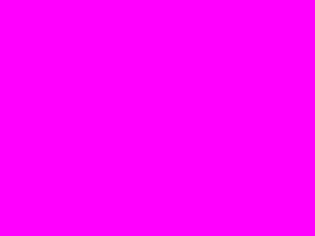 | `hb00_clear` | fastfill buffer clear + buffer swap |
| 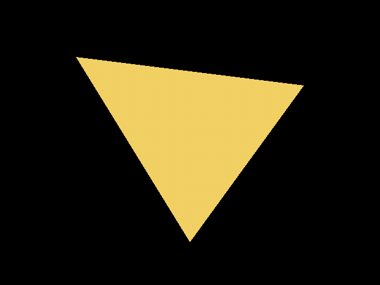 | `hb01_triangle` | single flat-shaded triangle (constant colour) |
| 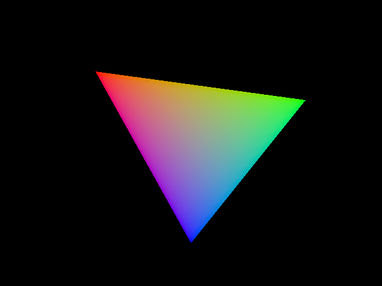 | `hb02_gouraud` | RGB gouraud (iterated-colour) shading |
| 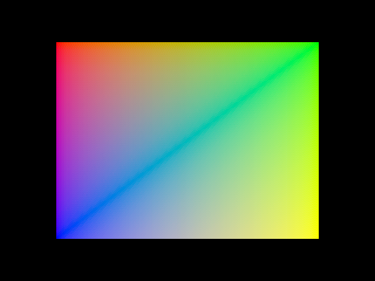 | `hb03_quad` | two-triangle gouraud gradient quad |
| 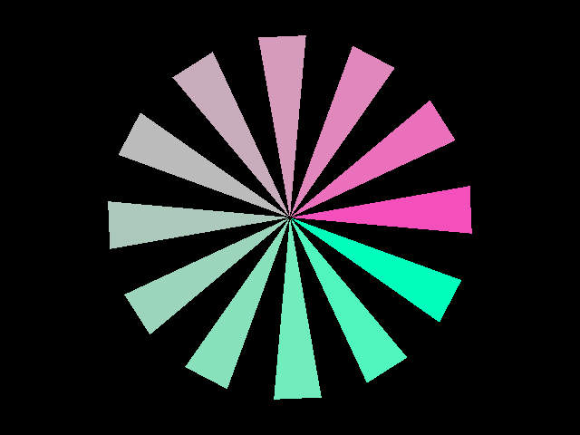 | `hb04_pinwheel` | many triangles/frame, per-blade colour |
| 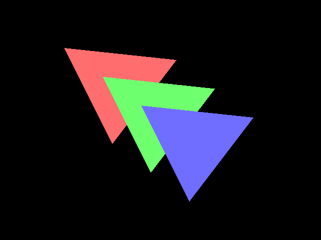 | `hb05_depth` | Z-buffer resolves overlapping triangles |
| 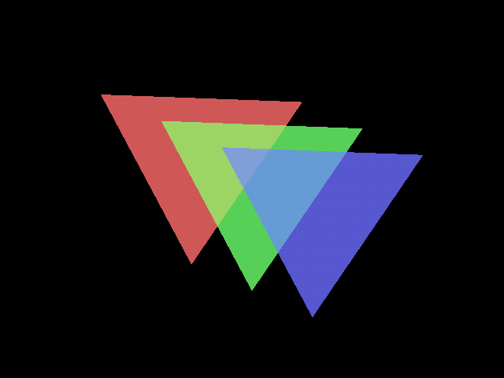 | `hb06_alpha` | src-alpha blending of translucent triangles |
| 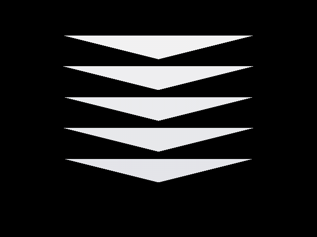 | `hb07_fog` | table fog fading receding triangles |
| 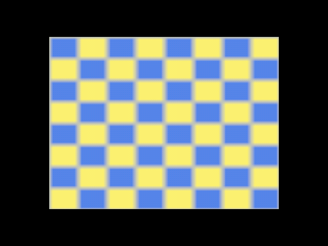 | `hb08_texture` | procedural texture download + bilinear filter |
| 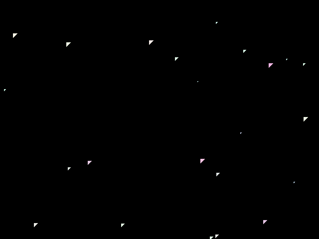 | `hb09_starfield` | high primitive count / throughput |

---

## 2. Console RTL renders (real `TangConsole138k` logic)

The generated `TangConsole138k` Verilog run in Verilator with a DDR model; the
on-screen menu is driven over the SNES-HID input and the parallel-HDMI output is
captured as 640×480 PNG. These are the built-in console demos playing through the
full menu → trace player → Voodoo core → DDR → HDMI scanout path.

| Image | Menu item |
|---|---|
| 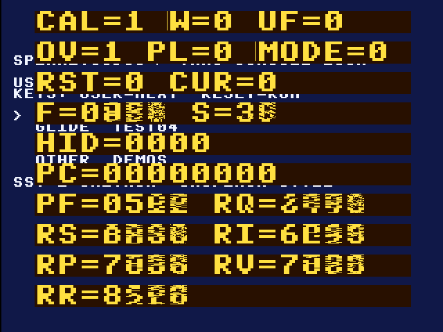 | Boot menu + debug HUD (`CAL/WED/USB`, `PC/BAR/N`) |
| 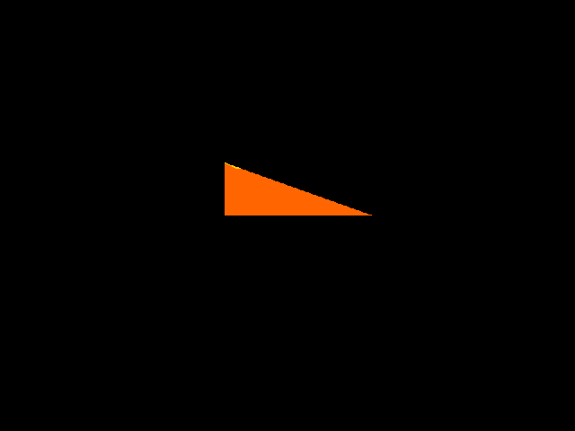 | 3dfx-style logo chevron |
| 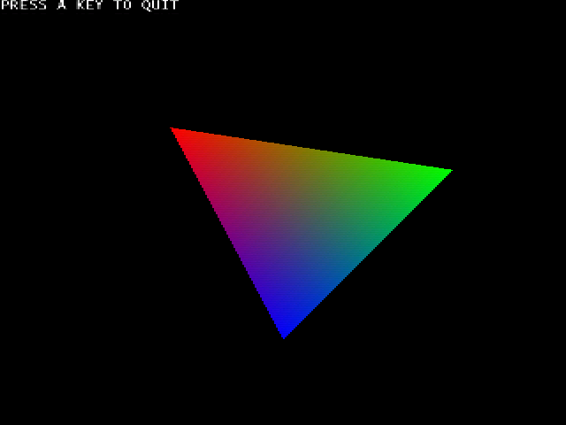 | Glide `test04` gouraud triangle |
| 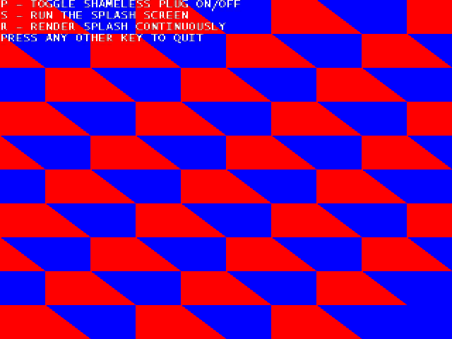 | Glide `test16` red/blue tiled pattern |
| 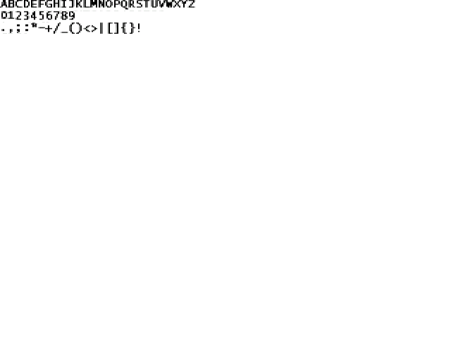 | Glide alphabet / textured glyphs |

---

## 3. DOS Glide binaries → FPGA sim

Real DOS Glide2x `.exe`s (built with Open Watcom + the 3dfx Glide SDK) run in a
32-bit DOSBox-X whose Glide passthrough forwards to the sim `libglide2x`; the
captured Voodoo command stream is rendered through the model
(`sw/glide-demos/dos-fpga/`).

| Image | DOS program |
|---|---|
| 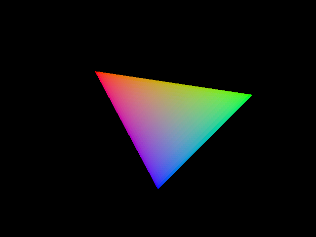 | `test04.exe` — gouraud triangle |
| 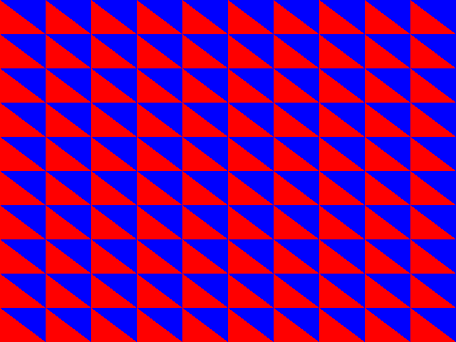 | `test16.exe` — tiled triangle pattern |
| 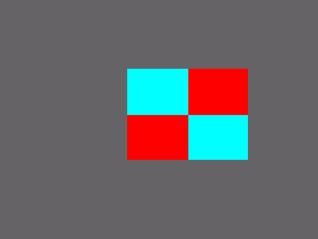 | `df02sdk.exe` — textured quad |

---

## 4. Games

An **open-source** third-party Glide program rendered all the way through the
Voodoo model — the clean answer to the passthrough problem below:

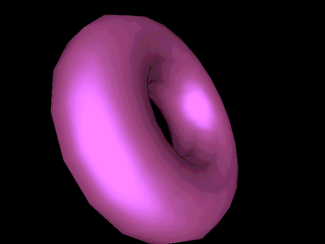

*efliks' GPLv3 [`nostalgic-glide-demo`](https://github.com/efliks/nostalgic-glide-demo)
— a spinning, environment-mapped torus drawn with direct Glide calls
(`grDrawTriangle` + env-map combiners). Built against our `libglide2x` (no
DOSBox, no PCI probing, no binary patch), traced, and replayed through the
Voodoo reference model. See `sw/glide-demos/nostalgic/`.*

| Image | What it is |
|---|---|
| 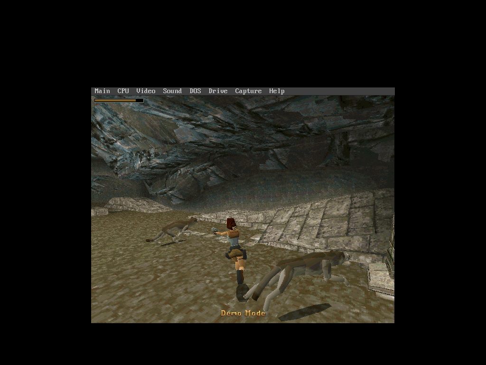 | Tomb Raider 3dfx **demo** running in the from-source 32-bit DOSBox-X. It renders in software (the demo's statically-linked real-PCI Glide falls back), so it does not forward to the sim — shown as "the game runs". |
| 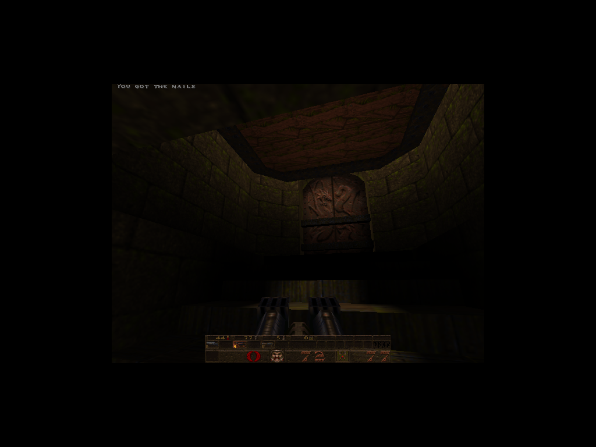 | Quake 1.06 **shareware** (`pak0.pak` extracted from `quake106.zip`) rendering the intro demo. Modern engine (QuakeSpasm) for an "it runs" proof — this is OpenGL, not the Glide/Voodoo path. |
| 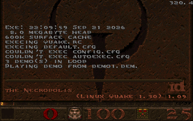 | The RISC-V Quake port (`sw/quake-riscv/`, soft `BarRv32` core target) booting the shareware and rendering its 2D/HUD via the software backend. Cross-built for RV32 in Docker. |

---

## 5. Docker-built Glide → FPGA sim

A Glide program built **inside a native i386 Docker container**
(`docker/glide32.Dockerfile`) against our `libglide2x`, run to capture a Voodoo
trace, then rendered on the host FPGA sim — proving the 32-bit Glide build path
without touching the host toolchain.

---

### How these were generated

- Homebrew ROMs + renders: `make -C sw/glide-homebrew` then `make -C sw/glide-homebrew render`.
- Open-source Glide game (torus): `make -C sw/glide-demos/nostalgic && make -C sw/glide-demos/nostalgic render`.
- Console RTL: the whole-console Verilator harness on the console branch (`amaranth/emu/console`, `make run-demos`).
- DOS Glide: `sw/glide-demos/dos-fpga/` (DOSBox-X + Open Watcom + 3dfx SDK).
- Games/Docker: see `docker/README.md` and `sw/quake-riscv/` on the console branches.
