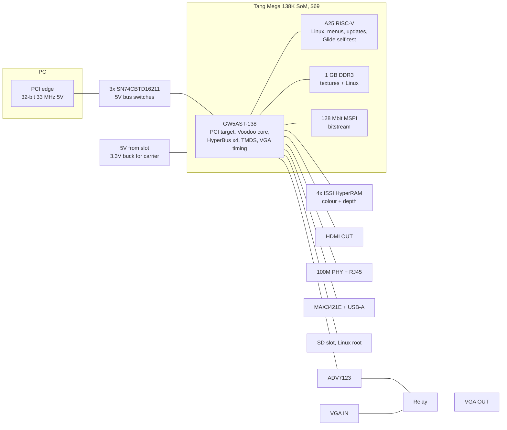

# Voodoo 2 card, module variant: Sipeed Tang Mega 138K carrier

Status: candidate design, 2026-09-16. Not chosen yet. Gated on a Gowin EDA
synthesis trial of SpinalVoodoo (see "Decision gate").

This document describes a version of the Voodoo 2 PCI card in which the FPGA,
its DDR3, its regulators, its configuration flash and the Linux companion CPU
are all replaced by one purchased module: Sipeed's Tang Mega 138K SoM. The card
becomes a four-layer carrier with no BGA on it. Everything below that concerns
the module is read from Sipeed's published SoM schematic, revision 30354
(`docs/tang_mega_138k_30354_som_schematic.pdf`), not estimated.

Related: `voodoo2-artix-card-plan.html` (rev A/B Artix card, the baseline),
`voodoo-fpga-options.html` (chip survey and live pricing),
`spinalvoodoo-artix-port.html` (porting assessment and fill-rate plan).

## 1. What the module is

| Item | From the schematic |
|---|---|
| FPGA | Gowin GW5AST-LV138PG484AC1/I0. 138,240 LUT4 (about 90K LUT6 equivalent), 6.1 Mbit block RAM, 298 18x18 multipliers, 12 PLLs, hard DDR3 controller, hard PCIe block, quad of 4 SerDes, two ADC inputs |
| CPU | Andes A25 RISC-V hard core inside the FPGA (AE350 subsystem), MMU, 400 MHz per Gowin, 800 MHz per Sipeed. Runs Linux |
| DDR3 | Two x16 chips, 32-bit bus, 1 GB, 800 Mbps, on the module with its own VTT regulator (`2 x DDR3` sheet) |
| Flash | 128 Mbit MSPI flash on bank 4 (`MSPI FLASH` sheet) |
| Clock | 50 MHz oscillator on the module into bank 4 |
| Power | Module takes 5 V. On-module DC-DC makes 0.9 V core, 1.2 V, 1.8 V, 1.5 V DDR, VTT and 3.3 V (`Board Power` sheet). Two bank I/O voltages, VCCIO2 and VCCIO67, are supplied by the carrier |
| Connectors | Two Hirose DF40C-100DP-0.4V(51) and one DF40C-80DP-0.4V(51). 280 pins total. 0.4 mm pitch, 3.0 mm stack height |
| Exposed I/O | Banks 2, 3, 4 and 5 on the connectors. Roughly 170 user I/O. Plus JTAG, MODE[2:0], DONE, READY, RECONFIG, CFGBVS, two ADC inputs |
| SerDes | Quad Q0: four TX/RX pairs plus reference clock pair, on the first 100-pin connector |
| Size | 35 x 45 mm |
| Price | $69 (Sipeed store, AliExpress). The bare chip is $152 at LCSC, so the module is the only cheap way to buy this silicon |

Mating parts for the carrier: DF40HC(3.0)-100DS-0.4V(51) x2 and
DF40HC(3.0)-80DS-0.4V(51) x1. About $8 for the set.

## 2. What changes against the Artix card

| | Artix card (rev A 100T / rev B 200T) | Module variant |
|---|---|---|
| FPGA | XC7A100T or 200T on a 484-ball BGA on our board | GW5AST-138 on the module |
| Logic for Voodoo 2 | 200T: 134.6K LUT6, about 50% full | 138K LUT4, 72% to 83% full |
| Block RAM | 200T: 13.1 Mbit, depth buffer on chip | 6.1 Mbit. Depth buffer cannot stay on chip beside the texture cache. Depth goes to HyperRAM |
| DDR3 | 2x DDR3L on our board, MIG, 6 layers | on the module, hard controller |
| Linux companion | Allwinner T113-S3 on our board, SPI link plus LCD-port pipe | A25 hard core on the internal AXI bus. This is the DE10-Nano architecture SpinalVoodoo was written for |
| Configuration | QSPI on our board, MultiBoot golden image, JTAG | MSPI flash on the module, JTAG on the connector |
| USB, Ethernet | native on the T113 | soft MAC in fabric plus a PHY; USB host through a MAX3421E SPI chip, or none |
| Toolchain | Vivado (free tier Windows-only in 2026.1), MIG | Gowin EDA Pro, free since 2024, Synplify inside (VHDL compiles), hard DDR3 and PCIe IP included |
| Board | 6-layer, BGA fanout, DDR3 routing | 4-layer, no BGA, three DF40 footprints |
| Supply | grey-channel Xilinx, several sources | Sipeed only. No cheap fallback on the same board |

What stays identical: the PCI edge and the three 5 V bus switches, the four
ISSI HyperRAM chips and the MJoergen controller, the VGA IN relay passthrough,
the ADV7123 DAC and VGA OUT, HDMI from fabric TMDS, the capture ADC footprint
left unpopulated, the expansion ribbon headers, and the SpinalVoodoo core with
the same PCI target, BMB memory backends and video wrapper.

## 3. Block diagram

## 4. I/O budget

| Function | Pins | Bank voltage | Notes |
|---|---:|---|---|
| PCI target | 50 | 3.3 V | AD[31:0], C/BE[3:0], FRAME, IRDY, TRDY, DEVSEL, STOP, IDSEL, PAR, CLK, RST, INTA, PERR, SERR. CLK on a clock-capable pin |
| HyperRAM, 4 channels | 49 | 3.3 V (ISSI is 3.0 V) | 4 x (8 DQ + RWDS + CS + CK + CK#) + shared RESET |
| ADV7123 DAC | 27 | 3.3 V | 24 data, CLK, BLANK, SYNC |
| HDMI TMDS | 8 | LVDS-capable bank | four pairs; Gowin TLVDS/ELVDS buffers, Sipeed ships DVI TX examples |
| Relay, LEDs, capture ADC reserved | 30 | 3.3 V | ADC unpopulated on v1, pins reserved |
| Ethernet RMII, MAX3421E SPI, SD | 18 | 3.3 V | |
| Expansion: 2 serial, parallel, MIDI, 2 Pmod | 46 | 3.3 V | optional, see the expansion section of the plan |
| Total | about 228 with expansion, about 182 without | | against roughly 170 exposed |

The core card fits. The full expansion set does not fit alongside it, so the
expansion headers are budgeted as: two Pmods (16) plus one serial and MIDI
(about 12), and the parallel port dropped, unless the exact per-bank count
from the schematic comes out higher than the estimate. Action: tabulate the
connector pin list from the schematic into a spreadsheet before schematic
capture. The rough count of 170 is from the BTB sheet and the bank sheets; the
exact number decides the expansion set.

Bank assignment to confirm from the schematic:

- VCCIO2 is carrier-supplied. Bank 2 is the largest exposed bank and should
  take PCI, at 3.3 V.
- VCCIO67 is carrier-supplied. Banks 6 and 7 are not on the connector in the
  rev 30354 schematic as read; confirm whether this rail matters.
- Banks 3, 4 and 5 have fixed I/O voltages on the module. Read them from the
  `FPGA POWER` sheet before assigning HyperRAM and the DAC. If a fixed bank is
  1.8 V it suits the DVI pairs and a future 1.8 V HyperRAM; if 3.3 V it suits
  the DAC.

## 5. Memory plan

| Buffer | Where | Why |
|---|---|---|
| Colour front and back, 1.2 MB at 640x480x16 | HyperRAM, two channels | same as the Artix plan |
| Depth, 600 KB | HyperRAM, the other two channels, behind the span cache | 6.1 Mbit of BRAM cannot hold it beside the texture cache. This is the one performance concession of the variant |
| Texture caches, FIFOs | BRAM | as on the Artix plan, sized by `tools/TmuTextureCacheBenchmark.scala` |
| Textures | module DDR3 via the Gowin hard controller | textures and the Linux root share 1 GB; the A25 gets a carve-out, the same way the DE10 build carved 16 MiB out of the HPS DDR |

Expected effect: large-triangle rows unchanged; the alpha-plus-Z small-triangle
rows land between the DE10 result and the Artix rev B plan. HyperRAM tACC is
35 ns against 150 to 300 ns on the DE10's shared DDR3 path, so the DE10 numbers
are the floor, not the expectation.

## 6. Host paths

- PC: the PCI target in fabric, as on every variant.
- A25: memory-mapped on the internal AXI bus. SpinalVoodoo's `de10` runtime
  maps the core through `/dev/mem`; on the A25 that is the same code with the
  base address changed. Host-less Glide self-test runs at full speed with no
  link hardware at all. This is the strongest argument for the variant.
- PCIe later: quad Q0 is on the connector. A PCIe x1 carrier variant needs the
  edge, a 100 MHz reference clock and PERST#, nothing else.
- Dev board: the Tang Mega 138K Pro Dock, $175, has a PCIe finger, DVI in and
  out, GbE and SD. Phase 1 runs on it in a Linux PC, and phase 2 can run on it
  in an old PC through a PCI riser breakout on ribbon, before any carrier
  exists.

## 7. Linux on the A25

- Boot: bitstream from the module's MSPI flash configures the FPGA and starts
  the A25. Linux root on an SD card on the carrier. Sipeed's Tang Mega
  examples boot Linux on this core.
- Peripherals: UART console on the carrier header; Ethernet through a soft MAC
  in fabric and an RTL8201F-class PHY; USB host through a MAX3421E on SPI, or
  omitted for v1; GPIO for the relay and LEDs.
- Duties: bitstream and firmware updates over Ethernet or USB, on-screen menu
  on HDMI, performance counters, screenshots and traces, the Glide regression
  suite.
- What is lost against the T113: two cores instead of one, native USB 2.0 and
  the LCD-port pipe. None of it matters here because the A25 is already on the
  bus the core lives on.

## 8. Power

- 5 V from the slot, filtered, straight into the module's 5 V input. The
  module's own regulators make every FPGA and DDR rail. Budget 6 to 8 W.
- One 3.3 V buck on the carrier for the bus switches, DAC, PHY, SD and relay,
  and to supply VCCIO2 (and VCCIO67 if used).
- No 1.0 V, 1.5 V, VTT or sequencing on the carrier. This is most of the reason
  the carrier is a four-layer board.

## 9. Cost

Prices are JLCPCB library prices where the part is in the JLC library, LCSC
otherwise, September 2026. The HyperRAM figure is the JLC price, not the LCSC
one.

| Item | Qty 5, each | Qty 100, each |
|---|---:|---:|
| Tang Mega 138K SoM | $69 | $69 |
| 3x DF40HC receptacles | $9 | $8 |
| HyperRAM, 4x ISSI IS66WVH8M8BLL at $6.59 | $26 | $24 |
| PCI bus switches, 3x SN74CBTD16211 | $6 | $5 |
| Power: 5 V filter, 3.3 V buck | $5 | $4 |
| Video: ADV7123, 3x G6K relays, 2x DB15, HDMI, ESD | $18 | $14 |
| Ethernet PHY and magjack, MAX3421E, USB-A, SD slot | $9 | $8 |
| Passives, headers, bracket | $12 | $10 |
| PCB, 4-layer, 175 x 107 mm, hard gold fingers, bevel | $20 | $9 |
| Assembly, JLCPCB standard, no BGA | $30 | $10 |
| Total | about $205 | about $160 |

For comparison, the Artix card at live JLC prices is about $220 to $230 at
qty 5 and $190 at qty 100 with the 100T, and $275 to $285 and $245 with the
200T. The module variant is the cheapest complete Voodoo 2-capable card and
the cheapest prototype, and it is the only one with no BGA on our board.

The saving comes from three places: the T113 and its subsystem are gone, the
FPGA is subsidised by Sipeed, and the board drops from six layers with a BGA
to four without one.

## 10. Risks

1. **Single source.** Sipeed is the only supplier of the module and the bare
   chip costs more than the module. If the module goes away, the design has no
   drop-in replacement; the fallback is the Artix card. Buy the run up front.
2. **Fit.** SpinalVoodoo has never been synthesised for a LUT4 fabric. The
   estimate is 72% to 83% for Voodoo 2. Utilisation above 85% on Gowin tends to
   hurt timing.
3. **Block RAM.** Depth in HyperRAM is a measured cost, not a guess, only after
   the port. It is the reason the variant may underperform rev B on small
   triangles.
4. **Toolchain.** Gowin EDA is free and adequate, but the open-source flow
   does not support GW5A yet, and the community is thinner than Xilinx's.
   VHDL for the HyperRAM controller relies on the bundled Synplify.
5. **I/O count.** The 170 figure is a reading of the connector sheet, not a
   tabulation. Tabulate before committing the expansion set.
6. **Module mechanicals.** 3.0 mm stack plus module components is about 5 mm,
   inside PCI's 14.5 mm. Confirm the module's tallest part and add mounting
   holes matching Sipeed's M1 to M4.

## 11. Decision gate and test plan

Gate, no hardware, one afternoon: generate SpinalVoodoo's Verilog, synthesise
for the GW5AST-138 in Gowin EDA with a 90 MHz constraint, read utilisation,
Fmax and BRAM. Pass: fits under 85% with 90 MHz met or within one pipeline
stage of it, and BRAM covers the texture cache and FIFOs with depth in
HyperRAM.

If it passes:

1. Buy a Pro Dock ($175). Port the memory backends (hard DDR3 IP for
   textures, HyperRAM controller for colour and depth is not on the dock, so
   textures and colour both in DDR3 for this step) and the A25 runtime. Run the
   Glide tests from the A25 over HDMI.
2. Build the PCI riser breakout on ribbon. Plug the dock into an old PC through
   it. Enumerate, then run the DE10 register model, then real Glide and Win9x
   drivers.
3. Design the carrier: tabulate the connector pins, KiCad footprints for the
   three DF40 receptacles, bank assignment, HyperRAM, video, expansion. Four
   layers. Order five.
4. Bring the carrier up with the same bitstream the dock ran, then add the
   HyperRAM backends and measure against the SpinalVoodoo README table.

If it fails, rev B stands and this document is closed.

## 12. Open questions

- Exact per-bank I/O count and each fixed bank's voltage, from the schematic.
- Whether VCCIO67 reaches any connector pin in rev 30354.
- Which A25 peripherals are hard (UART, SPI, I2C, GPIO) and which pins they
  come out on, from Gowin's AE350 hardware manual (MUG1031).
- Gowin's soft Ethernet MAC licence terms for a product.
- Sipeed's volume price and lead time for 100 modules.
