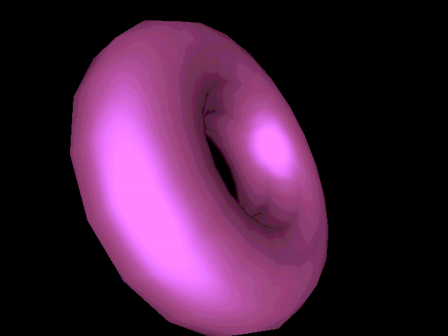

# An open-source Glide game through the FPGA simulator

This runs a real, third-party **open-source** 3Dfx Glide program end-to-end
through the SpinalVoodoo core-sim pipeline:

> **nostalgic-glide-demo** by Filip Eliáš (efliks) — GPLv3 — "Spinning 3D
> objects using the 3Dfx Glide library under MS-DOS."
> <https://github.com/efliks/nostalgic-glide-demo>

It renders a spinning, environment-mapped **torus** using direct Glide calls
(`grDrawTriangle`, `grTexDownloadMipMap`, `grTexCombine`, gouraud + env-map
combiners) — the exact same API surface a period Voodoo game uses.



*32-frame spin of the env-mapped torus, replayed through the 86Box software
Voodoo reference model (the golden model the RTL core is verified against).*

## Why this is the real fix for the "glide2x passthrough" problem

The freely-distributed **commercial** Glide demos (Tomb Raider, etc.) don't
work through DOSBox-X's Glide passthrough because they statically link an older
**real-PCI Glide** that probes the Voodoo hardware directly (PCI config scan +
memory-mapped SST registers). DOSBox-X's `glide=true` passthrough only forwards
the **SDK/OVL port-0x600** Glide protocol, so a real-PCI game finds no board and
falls back to software. See `../dos-fpga/README.md` for the full analysis and
why a "small binary patch" can't bridge that gap (the entire hardware-access
layer is compiled into the executable — patching it would mean replacing Glide,
not patching it).

The clean answer is to stop fighting the passthrough and instead take
**open-source** code that calls Glide through the standard library, and link it
directly against **our** `libglide2x` (the SpinalVoodoo sim backend). That is
precisely what the SDK tests and homebrew demos already do — and now a real
third-party open-source Glide program does it too. No DOSBox, no PCI probing,
no binary patching.

## How it works

`libglide2x` (built from `ext/SpinalVoodoo/emu/glide` in trace-capture mode)
implements the Glide 2.x API against the SpinalVoodoo core. The demo links it,
every `gr*`/`gu*` call is recorded to `SIM_TRACE_FILE`, and `trace_test`
replays that command stream through the reference model (or, optionally, the
cycle-accurate Verilator RTL core) to produce a framebuffer image.

Only the DOS-specific glue (`sys.c` timer/keyboard, `vga13h.c`) is replaced —
by `linux_sys.c` (no-op timing/input) and `driver.c` (a headless render loop
that renders a fixed number of frames and exits). The whole Glide render path
(`rsglide.c`, `bumpobj.c`, `envmap.c`, `math3d.c`, `texman.c`, `texglide.c`,
`bitmap.c`, `bumpmain.c`, `template.c`) is upstream, unmodified, and portable C.

The upstream project is vendored at `ext/nostalgic-glide-demo` (submodule).

## Build & run

```bash
# Needs the 32-bit multilib toolchain from .cursor/install.sh and the
# ext/SpinalVoodoo + ext/nostalgic-glide-demo submodules initialized.
make                 # build + capture the torus Glide trace (default 32 frames)
make render          # replay the trace -> shots/torus_ref.png
make FRAMES=8        # fewer frames = smaller trace / faster render
```

The **torus** is self-contained: its geometry comes from the vendored
`assets/models/torus.3d` and its environment map is generated procedurally, so
no external texture pack is needed.

The demo's other object, the **cube** (`make cube`), uses `MODE_TEXTURE` with
six `.pcx` textures that upstream distributes separately (a texture pack linked
from its README, not redistributable here). Drop those into
`ext/nostalgic-glide-demo/assets/textures/` and `make cube` will trace it too.
