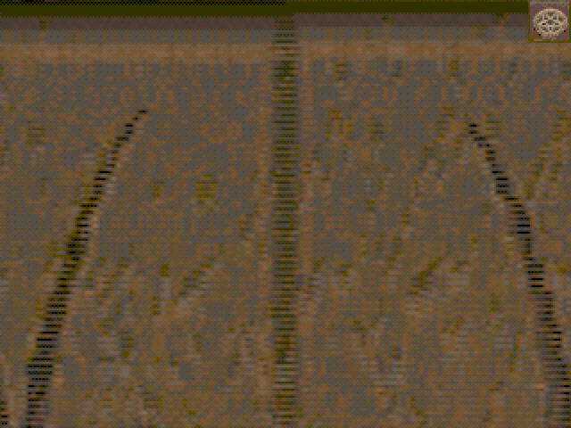

# GLQuake → Voodoo FPGA simulator (the Linux Glide route)

This is the concrete path to a **real, textured Quake frame** rendered through
the SpinalVoodoo core-sim pipeline, using the period-correct OpenGL→Glide stack
that shipped for 3dfx cards on Linux in 2000/2001:

```
id GLQuake (gl_vidlinux.c, fxMesa video backend)
  -> Mesa 3.4.2 "fx" driver           (OpenGL 1.1 implemented on Glide2)
    -> our libglide2x                 (SpinalVoodoo sim backend, trace capture)
      -> trace_test                   (86Box software Voodoo reference model)
        -> a real Quake frame (PNG)
```



*The Quake shareware `start` map, rendered by GLQuake through Mesa's Glide2 `fx`
driver into our `libglide2x`, then replayed through the 86Box Voodoo reference
model. Note the authentic 16-bit Voodoo ordered dithering.*

## Why this is worth the trouble

Unlike the DOS Glide game demos (which statically link a real-PCI Glide that
DOSBox-X's port-0x600 passthrough can't forward — see
`../glide-demos/dos-fpga/README.md`), GLQuake reaches the Voodoo through the
**standard Glide library**. GLQuake renders OpenGL; Mesa 3.4.2's `fx` driver
turns that into Glide2 calls; we link that against **our** `libglide2x`. No
DOSBox, no PCI probing, no binary patching — the same clean path our SDK tests,
homebrew demos and the open-source `nostalgic-glide-demo` already use, but now
driving a real, full game engine.

Everything ugly about a 2001-era Mesa/GLQuake build happens **inside the
`glide32` i386 Docker container** (`docker/glide32.Dockerfile`), so the modern
host toolchain is never touched. Only the trace render runs on the host.

## Running it

```bash
# Needs: Docker + the glide32 image, the ext/SpinalVoodoo submodule, the
# multilib host toolchain (.cursor/install.sh), and the Quake shareware pak.
# Put pak0.pak at sw/quake-glide/work/id1/pak0.pak (or sw/quake-riscv/id1/).
./build.sh              # patch, build libs + Mesa + GLQuake, run, render
./build.sh render       # just re-render the last trace
SECS=2 ./build.sh       # seconds to free-run the start map (default 2)
```

The result lands in `shots/glquake.trace_ref.png`.

### Gameplay video

`trace_test --dump-frames DIR` writes a PNG on every `swapbuffer` (carried in
`patches/spinalvoodoo-glquake.patch`). `capture-demo.sh` plays shareware
`demo1` through this path and encodes the frames.

A full minute of that video is not practical: with `-no8bit`, Quake re-uploads
textures as RGBA on a Voodoo1-class TMU, and the trace grows about half a
gigabyte per second (ISSUES.md F3). The default 12 s capture is long enough to
get past the loading plaque into the e1m3 flythrough. The matching full minute
is the software renderer:

```bash
./capture-demo.sh            # Voodoo reference-model clip  -> shots/glquake_demo1_voodoo.mp4
./capture-software.sh        # 60 s tyrquake software clip  -> shots/quake_demo_software.mp4
```

The Voodoo clip is the 320×240 view cropped out of the 640×480 framebuffer.
The software clip is tyrquake's native 320×200, scaled up with nearest-neighbor.
Both play shareware `demo1` (the software minute continues into `demo2` /
`demo3`). On this machine a 12 s GLQuake capture is about 2.5 GB and replays
to roughly 12 s of video at the swap rate (~70 fps), long enough to leave the
loading plaque, pick up the shells and the grenade launcher, and be in the
e1m3 corridor.

## How the build is put together

- **Mesa 3.4.2** is the last Mesa whose `fx` driver targets **Glide2** (our
  sst1/Voodoo1 backend); Mesa 4.x moved to Glide3. `build.sh` fetches it and
  builds `make linux-glide`, modernising the K&R-era source for gcc 12
  (`-std=gnu89 -fcommon`, and `-D__FUNCTION__=__FILE__` because pre-gcc-3.4
  treated `__FUNCTION__` as a string literal in `fprintf(stderr, __FUNCTION__ "..")`).
- **GLQuake** is the id GPL source. We build its `gl_vidlinux.c` **fxMesa**
  video backend, which calls `fxMesaCreateContext`/`fxMesaSwapBuffers` and
  renders straight to the Voodoo via Glide — **no X server needed**. Its DOS/
  svgalib console-input glue is replaced by the no-op stubs in `stubs/`
  (`vgakeyboard.h`, `vgamouse.h`, `asm/io.h`) since a headless timedemo needs no
  input, and `_fpcw_stub.c` supplies the FPU-control helpers that otherwise live
  only in x86 assembly (`quakedef.h` is forced to the portable C build).
- It runs headless with `-nosound` (no `/dev/dsp` in the container) and
  `-no8bit` (full RGBA textures instead of the paletted-texture extension, which
  the reference model doesn't carry a palette for), free-running the `start` map
  for a couple of seconds and stopping cleanly with SIGTERM so the trace flushes.

## Fixes this surfaced (carried as patches in `patches/`)

Driving a full game engine through the stack exposed three real bugs, fixed here
as patches applied to the vendored submodules (idempotently, by `build.sh`):

1. **`libglide2x` texture-memory size** (`spinalvoodoo-glquake.patch`, `init.c`).
   The sim backend can't probe the real RAM-sizing registers, so it reported
   0 MB. Mesa's `fxMesa` sizes its texture heap from `grTexMaxAddress()`, so a
   0 MB report underflowed and it tried to allocate millions of block nodes
   (`fxDriver: out of memory!`). Now it assumes a standard 2 MB Voodoo Graphics.
2. **86Box reference rasterizer robustness** (`86box-render-robustness.patch`,
   `vid_voodoo_render.c`). GL clients emit triangles with hardware clipping
   disabled and vertices projected far off-screen (negative `real_y`, huge `x`).
   The colour framebuffer base wasn't masked with `fb_mask` the way the aux/depth
   base is, so an off-screen scanline produced an out-of-bounds pointer and
   crashed. The patch masks the colour base like the aux path and clamps the
   per-pixel span to the framebuffer row (advancing the interpolators exactly as
   the `clipLeft`/`clipRight` path does).
3. **`trace_test` back-buffer fallback and per-swap dump**
   (`spinalvoodoo-glquake.patch`, `trace_test.cpp`). A static single-frame
   capture may be stopped with the freshly-drawn frame still in the **back**
   buffer, leaving the recorded "presented" buffer black. If the presented
   buffer is essentially all black but the other buffer clearly has content,
   `trace_test` now displays that one. `--dump-frames DIR` applies the same
   choice on every swap and writes a PNG, which is how `capture-demo.sh`
   builds a gameplay clip.

These are general improvements (memory reporting, rasterizer bounds-safety,
frame selection), not Quake-specific hacks; they belong upstream in
SpinalVoodoo/86Box and are kept here as patches only because those are vendored
submodules.
